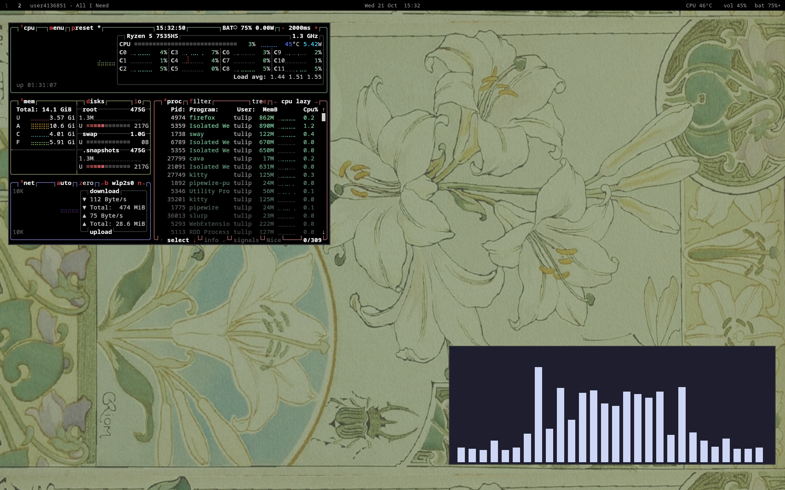

# SWAAYY QWWEEEN


Very minimal productivity setup, all you need. 


## Screenshot




## Dependencies

Install the required packages on Arch Linux:

```bash
sudo pacman -S --needed sway kitty rofi grim slurp swaybg swayidle swaylock swaync waybar wlogout brightnessctl pipewire pipewire-pulse wireplumber pavucontrol ttf-dejavu polkit
```

## Installation

Clone the repository:

```bash
git clone https://github.com/aww-y/sway.git
cd sway
```

Copy all included configurations into your config directory:

```bash
mkdir -p ~/.config
cp -r .config/* ~/.config/
```

Reload Sway to apply the changes:

```bash
swaymsg reload
```
